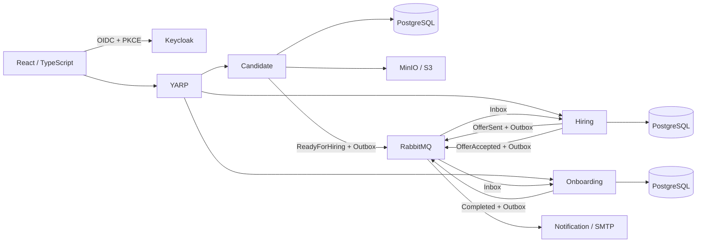

# NexusHR

NexusHR connects candidate verification, hiring offers and employee onboarding. A .NET 10 / React portfolio application with explicit business boundaries, durable messaging and tested failure handling.

**Verification:** see [integration results](docs/audits/integration-verification.md). Implementation, executed tests and production limitations are reported separately.

## Business workflow

Candidate registration → CV extraction/upload → document verification → hiring process → offer preparation/email → anonymous acceptance or rejection → onboarding tasks → HR completion → Hiring Completed.



## Stack

.NET 10, ASP.NET Core, EF Core/Npgsql, PostgreSQL 16, MediatR, FluentValidation, RabbitMQ/MassTransit EF Outbox/Inbox, Keycloak, MinIO SDK, PdfPig, React 19, TypeScript, MUI, Vite and Node 24. Testing uses xUnit, real PostgreSQL/MinIO Testcontainers and Playwright. Shared hosting provides ProblemDetails, JSON logs, correlation IDs, health endpoints and optional OpenTelemetry OTLP export.

## Start locally

Requires Docker Linux containers and Compose v2. Native development additionally needs .NET SDK 10.0.4xx and Node 24/npm.

```sh
docker compose config --quiet
docker compose up --build -d --wait --wait-timeout 300
docker compose ps
```

The first build compiles pinned official MinIO source because upstream public image distribution is unavailable. See [ADR 003](docs/adr/003-local-minio-source-build.md). Development migrations run automatically; named volumes are preserved. Stop with `docker compose down`; do not delete volumes to fix errors.

| Component | Local address |
| --- | --- |
| Web / Gateway | http://localhost:5173 / http://localhost:5000 |
| Keycloak / MailHog inbox | http://localhost:8080 / http://localhost:8025 |
| MinIO S3 / console | http://localhost:9000 / http://localhost:9001 |
| Candidate / Hiring / Onboarding APIs | http://localhost:5211 / http://localhost:5221 / http://localhost:5241 |
| RabbitMQ management | http://localhost:15672 |

**Development credentials only:** `hr.specialist`, `hr.manager`, `department.manager`, `it.specialist`, `finance.specialist` and `auditor` use `NexusHR123!` in the imported demo realm. Compose credentials are public fixtures. Never reuse them, HTTP settings or Keycloak `start-dev` in production. Realm import initializes new realms; it does not overwrite existing users/settings.

## Demonstration

1. Sign in as `hr.specialist`; open **CV’den aday oluştur**, select a text PDF, extract/review fields and save.
2. Review/download the CV in candidate detail; verify documents. Eligibility propagates asynchronously to Hiring.
3. Create a hiring process, prepare salary/currency/start date/expiry, and send the offer.
4. Open MailHog and follow the offer link in a private browser; accept without staff login.
5. Open **Onboarding** as HR or IT; start and complete the equipment, account and access tasks.
6. As HR, complete the ready onboarding. Hiring eventually becomes Completed with an employee reference.

Candidate contacts are editable until verification; verified snapshots are locked for Hiring. Upload failures can be retried against the existing draft. The onboarding aggregate is the employee profile/reference in this scope; payroll and attendance are not implemented. [Screenshot placeholders](docs/screenshots/README.md) are explicitly marked.

## Verification

```sh
docker compose build candidate-storage
dotnet restore NexusHR.slnx
dotnet build NexusHR.slnx
dotnet test NexusHR.slnx
dotnet tool restore
cd NexusHR.Web
npm ci
npm run lint
npm run build
npx playwright install chromium
npm run test:e2e
```

Backend infrastructure tests use isolated disposable containers, never business volumes. Browser E2E requires the complete stack and verifies real Keycloak login, CV extraction/storage, offer email/acceptance, task completion, final Hiring state and forbidden auditor upload. E2E supports `E2E_WEB_URL`, `E2E_API_URL`, `E2E_MAIL_URL`, `E2E_PASSWORD` for alternate demo environments.

CI builds/tests backend/frontend, checks migration drift, audits dependencies, starts Compose and runs browser E2E. A separate manual workflow publishes reviewed containers from main to GHCR under the `production` environment; it neither deploys nor merges PRs. Configure environment protection before releases.

## Configuration

Development connection strings and fixtures are confined to Development settings/Compose. Supply production values externally; nested .NET environment keys use double underscores.

| Variables | Purpose |
| --- | --- |
| `ConnectionStrings__CandidateDatabase`, `ConnectionStrings__HiringDatabase`, `ConnectionStrings__OnboardingDatabase` | Independent PostgreSQL connections |
| `RabbitMq__Host`, `RabbitMq__VirtualHost`, `RabbitMq__Username`, `RabbitMq__Password` | Broker access |
| `Minio__Endpoint`, `Minio__AccessKey`, `Minio__SecretKey`, `Minio__BucketName`, `Minio__UseSsl` | CV object storage |
| `Keycloak__Authority`, `Keycloak__MetadataAddress`, `Keycloak__ClientId` | Issuer, discovery and authorized web client |
| `Keycloak__Audience`, `Keycloak__RequireHttpsMetadata` | Production audience and HTTPS enforcement |
| `Smtp__Host`, `Smtp__Port`, `Smtp__SenderEmail`, `Smtp__SenderName`, `Smtp__UseSsl`, `Smtp__Username`, `Smtp__Password` | Email transport |
| `OfferResponse__PublicWebUrl` | Origin used in offer emails |
| `Database__ApplyMigrations` | Explicit startup migration opt-in outside Development; default false |
| `OTEL_EXPORTER_OTLP_ENDPOINT` | Optional logs/traces/metrics collector |
| `VITE_API_BASE_URL`, `VITE_KEYCLOAK_URL`, `VITE_KEYCLOAK_REALM`, `VITE_KEYCLOAK_CLIENT_ID` | Public frontend build settings, never secrets |

APIs expose `/health/live`, `/health/ready` and `X-Correlation-ID`. Readiness includes database and MassTransit checks; Gateway readiness is process-local. See [architecture](docs/architecture/overview.md), [deployment/recovery](docs/deployment.md) and ADRs below.

## Decisions and limitations

- [CV consistency](docs/adr/001-cv-upload-consistency.md): PostgreSQL and MinIO are not one transaction. Durable intents, bounded upload, one metadata/status commit and reconciliation protect failures and uncertain outcomes.
- [Event delivery](docs/adr/002-event-delivery.md): at-least-once messages, Inbox and business keys, bounded retries and `_error` queues. SMTP can still duplicate an email after an acknowledgement failure; offer decisions are single-use.
- [MinIO source build](docs/adr/003-local-minio-source-build.md): archived upstream is a production risk. Choose a maintained S3 service/distribution and validate compatibility before production data migration.
- Backend roles are authoritative; Admin has no implicit override. Only HR completes onboarding. Production requires HTTPS identity metadata and a configured audience mapper. Local JWTs validate issuer/signature/lifetime and authorized party.
- Offer tokens are random, hashed, expiring and consumed once; responses have rate/body limits and optimistic concurrency protection. Proxy topology must be configured before public exposure.
- PDF extraction is heuristic and bounded, not OCR or malware scanning. No request body, CV content or bearer token is deliberately logged.
- HA, backup/restore drills, tenant/department restrictions, production TLS/secrets and load testing require deployment-specific acceptance work. This repository is not a certified production deployment.
