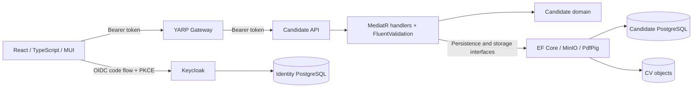

# Architecture overview

Audit date: 2026-10-26. This describes the checked-in implementation; runtime behavior has not been verified in this environment.

## Boundaries and persistence

- Domain owns Candidate and CandidateDocument entities and status transitions: Draft -> DocumentsPending -> ReadyForHiring; Archive is a domain operation without an API endpoint.
- Application contains commands, queries, response records, validators, and persistence/document interfaces. Validation is invoked explicitly by create, update, extraction, and upload handlers; there is no validation pipeline behavior.
- Infrastructure implements repositories with EF Core/Npgsql, object storage with MinIO, and heuristic PDF text extraction with PdfPig. Repositories save independently. There is no explicit application unit of work.
- API maps HTTP contracts to MediatR requests. It performs migrations at startup. Three migrations exist (the intermediate AddCandidateDocuments migration is empty); the final snapshot includes unique email, object name, and candidate/document-type indexes and a cascading candidate foreign key.
- Gateway proxies `/api/candidates/{**catch-all}` under an authenticated-user policy. Candidate API independently enforces authentication and endpoint roles and is also directly exposed locally.
- Shared Security validates issuer, lifetime, signature, and `azp` against the web client, then maps Keycloak realm roles to .NET role claims. Audience validation is disabled. There is no implicit Admin override.

## Implemented product surface

Candidate create/update, paginated search/filter, detail, CV extraction/upload/download, and document verification endpoints exist. The frontend provides list, creation from CV, and detail/verification/download pages with role guards and loading/error states. It does not expose candidate editing or retrying upload against an existing draft.

| Operation | Intended permitted realm roles |
| --- | --- |
| Candidate list/detail | HrSpecialist, HrManager, DepartmentManager, Auditor |
| Create/update/extract/upload/verify | HrSpecialist |
| CV download | HrSpecialist, HrManager, Auditor |

The initial audit found upload enforcing only authentication. The first Phase 1 change adds the existing CandidateEditors restriction to that endpoint. DepartmentManager intentionally cannot download CVs despite reading candidate records.

## Consistency boundary

Upload writes MinIO, inserts document metadata (one database commit), then changes candidate status (another commit). Only metadata-insert exceptions trigger object deletion. A later status/save failure can leave inconsistent data; deletion can itself fail or mask the original exception. Prechecks do not prevent database uniqueness races. PostgreSQL and MinIO do not share an atomic transaction.

The next milestone should commit metadata and status together within PostgreSQL, validate the transition before external I/O, and use explicit compensation plus durable reconciliation for storage failures and uncertain outcomes. It must address concurrent updates rather than relying on prechecks.

## Local deployment and missing components

Compose defines Candidate PostgreSQL, identity PostgreSQL, Keycloak, MinIO, Candidate API, Gateway, and frontend. Host ports are 5433, 5434, 8080, 9000/9001, 5211, 5000, and 5173 respectively. API and Gateway validate the browser-facing localhost issuer while Compose uses internal Keycloak metadata URLs.

Hiring, RabbitMQ, MassTransit, domain integration events, Outbox/Inbox, distributed workflow coordination, CI/CD, OpenTelemetry, and end-to-end tests are absent. Gateway `/health` is a static liveness response; Candidate dependency readiness checks are absent. Built-in logging exists but there is no configured trace/metrics exporter. All supplied credentials and HTTP settings are local-development fixtures, not production deployment settings.
