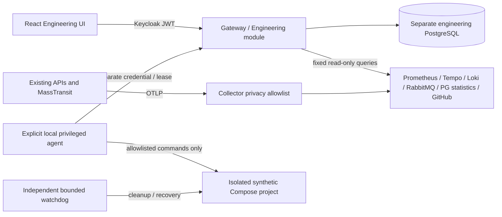

# Engineering Control Center

The opt-in `/engineering` module is a technical administration surface, separate from HR workflows. It uses Gateway and the existing Keycloak browser login. Backend policies are authoritative: EngineeringReader can inspect metadata; EngineeringOperator can additionally approve/cancel bounded synthetic experiments. Neither grants CV, candidate, offer or onboarding permissions. Existing HR/Admin roles are not engineering permissions.

## Architecture

Read [ADR 009](adr/009-engineering-control-plane.md). The existing service ownership, repository boundaries, telemetry hooks, k6 fixture, messaging, recovery tests, Docker/CI and web routes were inspected before choosing this design. The implementation adds a protected module rather than another business microservice.



The API has no Docker socket. Experiment history and audit events are durable, idempotency keys are checked against complete request parameters, only one lease is active globally, and late results from an old lease are rejected. A bounded pending queue prevents unlimited admission. Requests cannot provide URLs, SQL or shell commands.

## Development setup

Run commands from the repository root with .NET 10, Node 24/npm and Docker Linux containers. Keep existing application data and volumes; never use `down -v` or reset a database.
Start the base application first using the README. The provisioning step requires its existing development Keycloak, PostgreSQL and RabbitMQ containers.

```powershell
node scripts/engineering/bootstrap.mjs
# Supply existing DEVELOPMENT administrator credentials through environment variables.
# ENGINEERING_KEYCLOAK_ADMIN_PASSWORD / ENGINEERING_RABBIT_ADMIN_PASSWORD
node scripts/engineering/bootstrap.mjs --provision --from-development-containers

docker compose --env-file .tools/engineering/engineering.env -f docker-compose.yml -f docker-compose.engineering.yml --profile engineering up --build -d --wait
```

Bootstrap generates random credentials into ignored `.tools/engineering/access.json`, a private Compose env file and a separate synthetic lab realm. Windows ACLs are restricted to your account and SYSTEM before writing; Unix files use mode 0600. `--from-development-containers` accepts only the verified local Compose Keycloak `start-dev` deployment, reading its administrator credentials in memory. Alternatively supply administrator credentials using the environment variables shown above. The provision step adds technical users/roles and metadata-only PostgreSQL/RabbitMQ accounts. It does not reset users/passwords or application data. Repeating with an existing, **original** access file requires `--existing-owned-users`; never use that switch with regenerated credentials for an unrelated user.

Technical users are `engineering.reader` and `engineering.operator`; their passwords are generated, not development constants. Grafana is bound to loopback port 3000 with its separately generated `engineering` administrator password. The application remains on port 5173. Add the existing AI, multimodal and security overlays when preserving an already enabled local AI/OCR/scanner stack.

Only the observability profile enables Engineering. It is disabled in ordinary Compose/CI. Production execution and automatic engineering schema initialization are rejected. Backend data-source TLS/secret provisioning and production deployment acceptance remain separate work; this is a trusted local development platform, not a hosted multi-tenant execution service.

## Sources and interpretation

- Prometheus holds 24-hour / 512 MB bounded local metrics; SVG graphs use actual samples and display missing data explicitly. CPU is percent of one core; Linux exporter host values describe Docker's VM, not Windows. Polling/probes themselves create traffic.
- Grafana provisions the NexusHR Engineering dashboard (HTTP rate/p95/errors and container working memory) and Prometheus/Tempo/Loki sources. Authentication remains enabled; its administrator credential is separate from Keycloak.
- Tempo stores sanitized spans: IDs, service relationships and durations, without CV text, URLs, SQL statements, exception messages or stacks. Parent relationships do not prove a causal critical path for concurrent asynchronous processing.
- Loki stores redacted events for 24 hours. Raw messages and stack traces are intentionally withheld. Trace/correlation IDs connect diagnostics without exposing documents or tokens.
- PostgreSQL diagnostic accounts use pg_monitor and read-only sessions with statement deadlines. Connections, cumulative transactions/deadlocks, locks, size and index usage come from statistics views. pg_stat_statements query fingerprints appear only if the extension was enabled through a planned maintenance change; no SQL text or arbitrary EXPLAIN is exposed.
- RabbitMQ uses a separate monitoring account with no configure/write/read-message permissions. Queue/exchange/consumer counts and measured rates are metadata, not proof of successful business processing. Message replay is not implemented.
- GitHub uses fixed read-only APIs for this repository; an optional backend-only `Engineering__GitHubToken` can increase the rate limit. Run/step conclusions are not parsed test counts, vulnerability totals or proof of deployment. Snapshots are cached, not fabricated.
- AI diagnostics project aggregate states and bounded 24-hour attempt statistics without CVs, users, quotes or document IDs. Source-grounding validity is not extraction accuracy. Effective token throughput includes the pipeline; native decoder rate is not inferred from it.

## Isolated load and chaos lab

The lab uses a separate realm/issuer, disposable project labels and RAM-only PostgreSQL/object/broker stores. Its tokens are rejected by the business issuer. Only fixed internal targets are used. Server VU limits default to 100, independently bounded agent/container budgets and a 10,000-request step budget apply, and duration/ramp/queue/total execution time are capped. Presets up to 10,000 VUs are configuration choices, not promises of sustainable capacity. High-load runs are never routine CI.

Prepare the lab with the following commands after the engineering stack is ready. `lab-ollama` reads only the `models` subdirectory of the existing local model cache, mounted read-only; no user files, histories or main model settings are shared. Provision cached model weights separately if using AI benchmarks; the agent never downloads models.

```powershell
docker compose --env-file .tools/engineering/engineering.env -f docker-compose.engineering-lab.yml build
docker compose --env-file .tools/engineering/engineering.env -f docker-compose.engineering-lab.yml up -d candidate-db hiring-db rabbitmq candidate-storage lab-keycloak lab-ollama fault-proxy
node scripts/engineering/lab.mjs --initialize
docker compose --env-file .tools/engineering/engineering.env -f docker-compose.engineering-lab.yml up -d --wait --wait-timeout 240
node scripts/engineering/agent.mjs
```

The last command stays in the foreground. Stop with Ctrl+C after the active experiment has recovered; do not stop Docker midway through recovery. Sign out of any HR session and sign in with a generated technical account. Open `http://localhost:5173/engineering`; Grafana is at `http://localhost:3000`. Read the corresponding operator/reader/Grafana password only from the private access file. A 403/access-denied page with an HR account is expected, including Admin.

For PostgreSQL query fingerprints, schedule a local database restart with the additional `docker-compose.engineering-postgres.yml` overlay, then repeat metadata provisioning using the original credential file and `--existing-owned-users`. This preserves named volumes and adds `pg_stat_statements`; it is optional, not a production migration. No arbitrary SQL or query text is exposed.

Capacity exploration reports last tested passing and first observed SLO breach. Resource exhaustion or insufficient telemetry is inconclusive, not a capacity limit. CPU SLO needs three measured samples; short tests can be inconclusive. JSON/CSV export includes measured counters and percentiles, not extrapolated production capacity.

Chaos is restricted to the lab's stateless Candidate container and its database/broker network proxies. Cleanup happens before the final result releases the execution slot. An independent watchdog survives agent termination; unavailable Docker/host infrastructure can still prevent recovery, which must be reported rather than guaranteed. No business volume or database is a fault target.

## Diagnosis

The UI is a window into the system, not an authority over HR records. Prometheus stores numeric measurements; Grafana explores them. Tempo links timing spans by trace ID. Loki stores sanitized events. The collector removes sensitive content before storage. The agent executes fixed commands only inside the synthetic lab; PostgreSQL records approval, idempotency and fenced leases. k6 measures requests and latency; Toxiproxy injects bounded network faults. These components help explain bottlenecks without claiming that a single laptop benchmark predicts production capacity.

Start with readiness and service RPS/p95. Select a trace ID for parent/service timings and correlate redacted logs. Inspect database lock waits, cumulative transaction deltas and index scans; absent pg_stat_statements means unavailable slow-query data. Inspect broker `_error`/`_skipped` queues and consumer/rate trends without fetching payloads; use existing messaging integration tests to verify retry/dedup semantics. Preserve evidence and use approved offline diagnostics for information intentionally withheld by the dashboard.

## Verification

Execution evidence is recorded during implementation and on the PR. No production deployment, business database reset or volume deletion is authorized. Existing Candidate/Hiring/Onboarding, CV storage, AI/OCR and malware-scanning regressions remain required gates.

See [executed engineering verification](audits/engineering-control-center.md) for measured results and limitations. Routine CI validates policies/configuration and the existing full regression suite. The manual `Engineering lab verification` workflow additionally requires explicit approval and runs only bounded synthetic load/recovery checks, never model downloads or paid AI calls. Local model benchmarks require `RUN_ENGINEERING_BENCHMARK=1` separately and available cached weights.

```powershell
node --test scripts/engineering/lab.test.mjs scripts/engineering/benchmark.test.mjs
node scripts/engineering/verify-telemetry.mjs
$env:RUN_ENGINEERING_TESTS='1'
$env:RUN_ENGINEERING_EXECUTION='1'
cd NexusHR.Web
npm run test:e2e -- engineering.spec.ts
```

The final command skips the expensive model benchmark unless its additional flag is set. Start the agent before execution tests. Logs, generated credentials, model inputs, raw test outputs and local tools remain ignored. Do not upload private diagnostic directories as CI artifacts.

Primary configuration references: [Npgsql diagnostics](https://www.npgsql.org/doc/diagnostics/overview.html), [Collector transform processor](https://github.com/open-telemetry/opentelemetry-collector-contrib/tree/main/processor/transformprocessor), [Tempo 3 configuration](https://grafana.com/docs/tempo/latest/configuration/), [Loki HTTP API](https://grafana.com/docs/loki/latest/reference/loki-http-api/).
