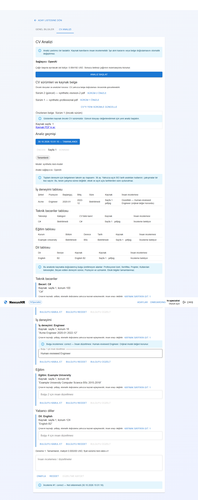

# Synthetic browser capture

`engineering-overview.png`, `engineering-load.png` and `engineering-ai.png` are actual authenticated Playwright captures of the opt-in local Engineering Control Center. Charts and experiment reports come from running services and the isolated synthetic lab; no source metrics or run responses are mocked. The technical development account has no candidate/CV permissions. Regenerate deliberately with `RUN_ENGINEERING_TESTS=1`, `RUN_ENGINEERING_EXECUTION=1` and `CAPTURE_ENGINEERING=1`. The overview/AI captures can also be refreshed using the reader test without executing another experiment. Never capture credentials or live CV data.

Captured by Playwright `portfolio-review` against the frontend and isolated PostgreSQL/RabbitMQ/MinIO backend with a deterministic test provider. All displayed records are synthetic. Native Qwen/OCR evidence is reported separately.

[Actual OCR + qwen3:4b browser capture](ocr-ollama.png) was produced by `OcrOllamaWorkflowTests` with `RUN_OCR_OLLAMA_TESTS=1`, `RUN_OCR_BROWSER_TESTS=1` and `CAPTURE_PORTFOLIO=1`. The scanned document, OCR, model, evidence and persisted results are real; only the identity test boundary and an unrelated Hiring availability response are isolated. No CV/result response is mocked. The input is synthetic. The Playwright check verifies employment/education/skill tables, the grounded employer, provenance and zero API cost.

Regenerate deliberately with `CAPTURE_PORTFOLIO=1` and `RUN_AI_BROWSER_TESTS=1` when running `AiBrowserTests`. Ordinary runs do not overwrite documentation. Never capture live candidates, credentials, offer links or tokens.
