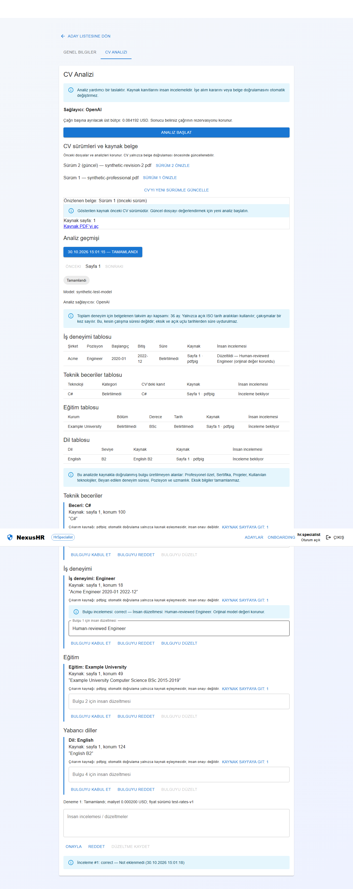

# Synthetic browser capture

Captured by Playwright `portfolio-review` against the frontend and isolated PostgreSQL/RabbitMQ/MinIO backend with a deterministic test provider. All displayed records are synthetic. Native Qwen/OCR evidence is reported separately.

Regenerate deliberately with `CAPTURE_PORTFOLIO=1` and `RUN_AI_BROWSER_TESTS=1` when running `AiBrowserTests`. Ordinary runs do not overwrite documentation. Never capture live candidates, credentials, offer links or tokens.
